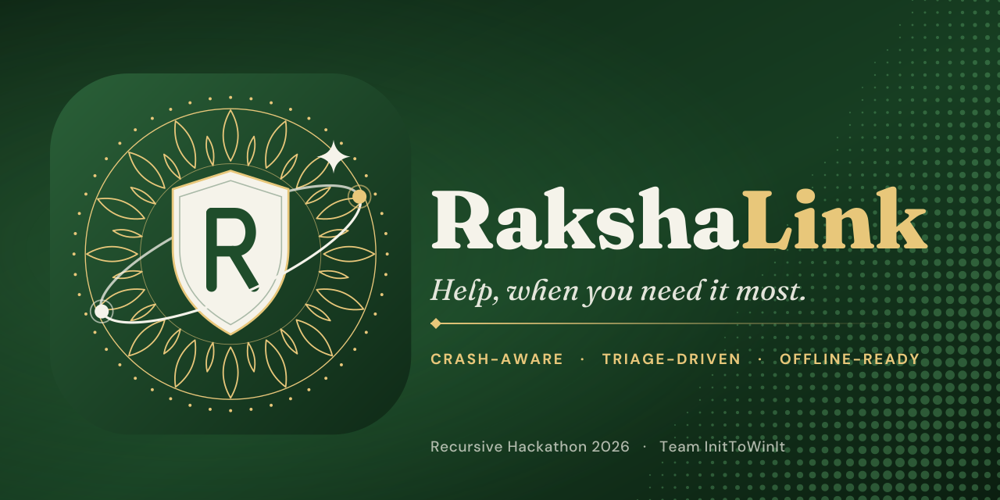
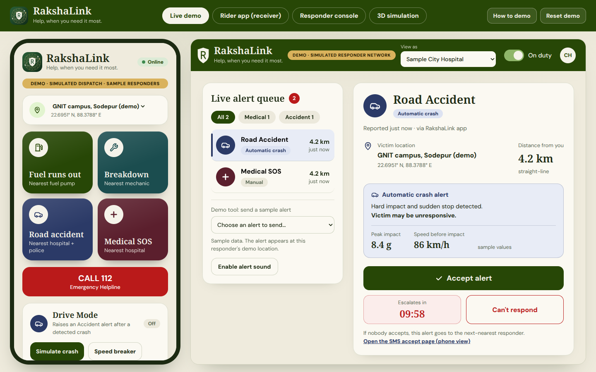
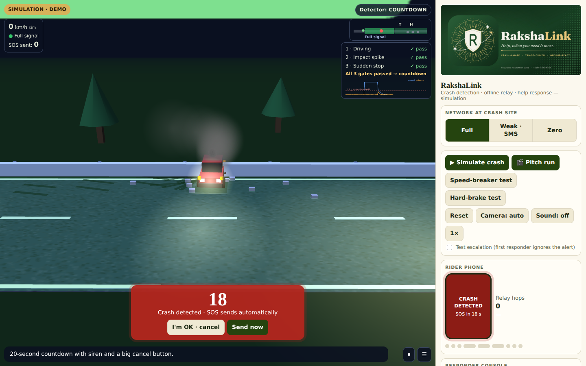
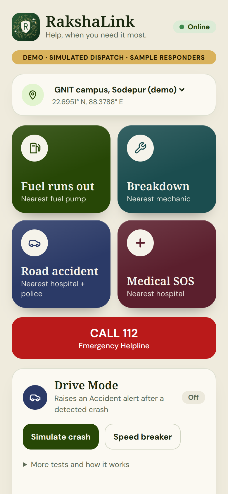
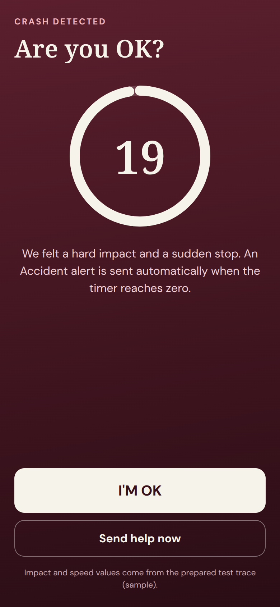
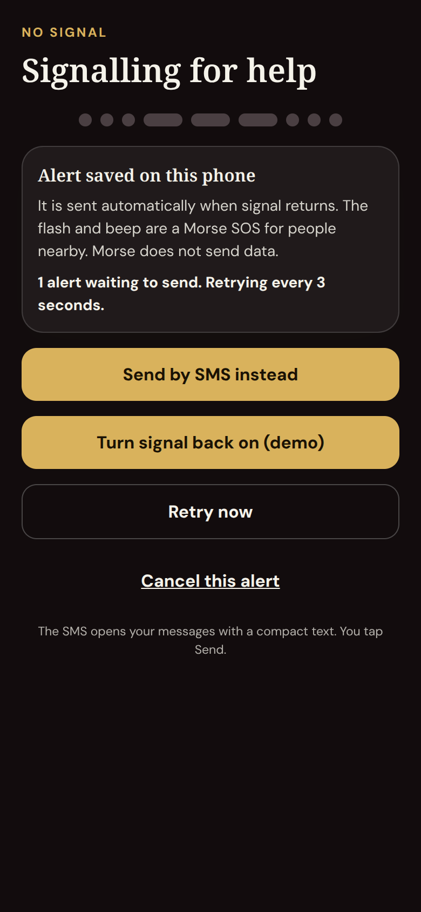
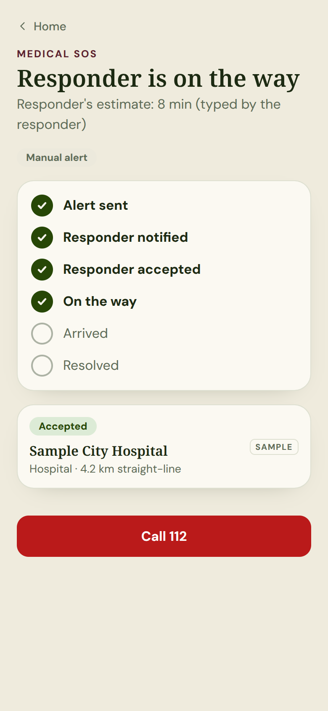
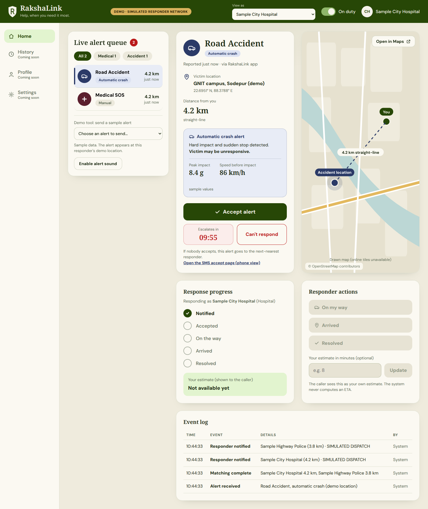
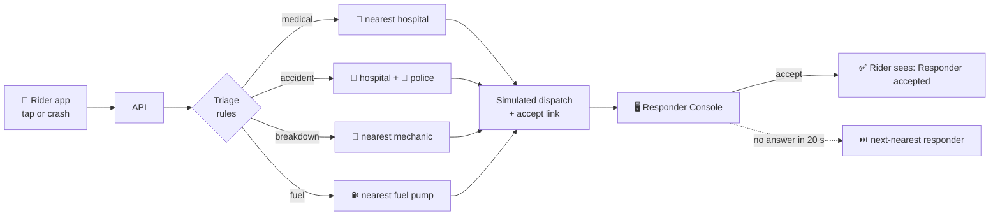
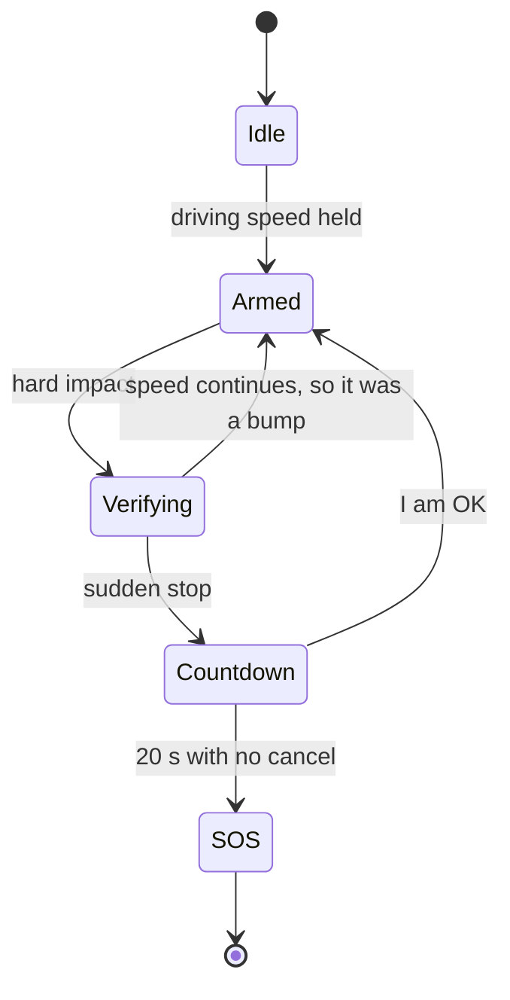

<p align="center">
  
</p>

<h3 align="center">Not just an SOS button.<br>A triage agent that knows exactly who to call, online or off.</h3>

<p align="center">
  
  
  
</p>
<p align="center">
  
  
  
  
</p>

<p align="center">
  <a href="#run-it">Run it</a> &nbsp;·&nbsp;
  <a href="#the-interfaces">Interfaces</a> &nbsp;·&nbsp;
  <a href="#how-it-works">How it works</a> &nbsp;·&nbsp;
  <a href="#whats-real-and-whats-simulated">Real vs simulated</a> &nbsp;·&nbsp;
  <a href="#build-status">Status</a> &nbsp;·&nbsp;
  <a href="#deploy">Deploy</a> &nbsp;·&nbsp;
  <a href="#team-inittowinit">Team</a>
</p>

<p align="center"></p>

## Why RakshaLink exists

According to the Ministry of Road Transport and Highways (*Road Accidents in India 2023*), India recorded **4,80,583 road accidents** and **1,72,890 deaths** in 2023, about **20 deaths every hour**. National and State Highways together account for roughly **59%** of those deaths. Most emergency apps assume you have signal, can unlock your phone, and can explain what you need. On a highway, you often can't.

RakshaLink is built for that moment: one tap, or **no tap at all**.

<table align="center">
  <tr>
    <td align="center" width="33%"><b>One tap, or no tap</b><br><sub>Four emergencies on one screen. Drive Mode raises an Accident alert after a detected crash, with a 20-second cancel window.</sub></td>
    <td align="center" width="33%"><b>The right responder</b><br><sub>Hospital, police, mechanic or fuel pump by category and distance. Escalates to the next-nearest if nobody answers.</sub></td>
    <td align="center" width="33%"><b>Built for weak signal</b><br><sub>No signal: a Morse SOS screen flash, a prefilled SMS, and a saved queue that delivers when signal returns.</sub></td>
  </tr>
</table>

## Run it

```bash
git clone https://github.com/ashishacharjee/RakshaLink.git
cd RakshaLink
npm install
npm start            # open http://localhost:3000
```

Needs Node 18 or newer. Nothing else: no database, no API keys. To use it from a phone on the same Wi-Fi, open `http://<your-laptop-ip>:3000/rider`.

```bash
npm test                                   # 24 unit and API tests
npm i --no-save jsdom && npm run check:ui  # 36 end-to-end UI checks (real pages, real server)
```

## The interfaces

| URL | Who it is for | What it is |
|---|---|---|
| `/` | Everyone | **Live demo hub** with four tabs: *Live demo* (the rider phone and the responder console side by side, full size), *Rider app*, *Responder console*, *3D simulation*. Plus a how-to and a reset button. On a phone it shows three launch buttons |
| `/rider` | The person in trouble (the receiver) | Mobile app: four emergency tiles, Drive Mode crash detection with a 20 s countdown, live status, offline mode |
| `/console` | Hospitals, police, mechanics, fuel pumps | Desktop Responder Console: live queue, map, accept or decline, step progress, event log |
| `/r/<token>` | A responder on a phone | The page an SMS link would open: accept, On my way, Arrived, Resolved |
| `/simulation/` | Anyone | **3D simulation** (Three.js) of the crash, the offline relay concept and the help response |

## Screens

Real screenshots of the running app, taken in a test browser without internet access. That is why the console shows its built-in drawn map; with internet it uses OpenStreetMap tiles.

<p align="center"></p>

<p align="center"></p>
<p align="center"><sub>The 3D simulation at the crash countdown: driving, impact spike and sudden stop have all passed.</sub></p>

<table align="center"><tr>
<td align="center" width="25%"><br><sub>Rider home</sub></td>
<td align="center" width="25%"><br><sub>Crash countdown</sub></td>
<td align="center" width="25%"><br><sub>Offline: Morse SOS</sub></td>
<td align="center" width="25%"><br><sub>Real status steps</sub></td>
</tr></table>

<p align="center"></p>
<p align="center"><sub>Responder Console, with an automatic crash alert waiting to be accepted.</sub></p>

## How it works





- **Triage** is a fixed table, unit-tested: medical goes to a hospital, accident to a hospital and the police, breakdown to a mechanic, fuel to a fuel pump. Nearest first, by straight-line distance.
- **Responder steps** are set only by the responder: Accepted, On the way, Arrived, Resolved, in order. The rider screen shows only those real steps. It never says help is coming before a responder accepts, and shows an estimate only if the responder typed one.
- **Escalation:** no accept in 20 s (configurable) and the alert goes to the next-nearest responder of that type. After three attempts the rider is told: *No responder answered. Call 112.*
- **Crash detection** needs driving speed, a spike of at least 4 g, and a stop within 3 s. A speed breaker, a pothole, hard braking, or a drop while parked is ignored. Five prepared traces are replayed through the real detector.
- **Offline:** no signal means the alert is saved on the phone, the screen flashes a Morse SOS with a beep for people nearby, a prefilled SMS is offered, and the alert is delivered, tagged *Delivered from queue*, when signal returns.

## What's real and what's simulated

| Part | Status |
|---|---|
| Triage, matching, escalation, status steps, queue, SSE live updates | **Real code**, covered by tests |
| Responders (24) | **Sample data** placed around two demo locations, clearly labelled "Sample" |
| SMS and voice dispatch | **Simulated and labelled** "SIMULATED DISPATCH". No SMS provider is connected |
| Location | Two **presets** (GNIT campus, an NH-19 sample point) because GPS is unreliable indoors |
| Crash detection | **Prototype heuristic**, not validated on real crashes. Demo replays prepared traces. No live sensor mode |
| Morse | A screen flash and a beep for people nearby. **It does not send data.** The saved alert is delivered when signal returns |
| SMS fallback | The prefilled text and `/api/sms/inbound` parser exist. A real SMS gateway number does not |
| Map | OpenStreetMap tiles through a bundled copy of Leaflet (© OpenStreetMap contributors). If tiles cannot load, a drawn map takes over |
| Data | In memory. A restart or the reset button clears it |

RakshaLink **augments** India's 112 number; it does not replace it. A Call 112 link is on every rider screen.

## Build status

| Tier | Feature | Status |
|---|---|---|
| T1 | One-tap SOS, four categories | ✅ |
| T1 | Triage and nearest-responder matching | ✅ |
| T1 | Simulated dispatch with accept links | ✅ |
| T1 | Responder Console and phone accept page, live updates | ✅ |
| T1 | Rider status with real steps only | ✅ |
| T1 | Drive Mode: replayed crash, 20 s countdown, automatic alert | ✅ |
| T2 | On duty toggle, On the way / Arrived / Resolved, per-responder queue | ✅ |
| T2 | Escalation to the next-nearest responder, then "call 112" | ✅ |
| T2 | Offline: saved queue, Morse flash, prefilled SMS, delivery tag | ✅ |
| T2 | Time-to-dispatch metrics (`/api/metrics`) | ✅ API only, no screen yet |
| T2 | Live sensor crash detection | ⬜ not built |
| T2 | Family alert, real SMS gateway | ⬜ not built |
| T3 | Voice SOS, language toggle, history, operations overview | ⬜ not built |

## Tech stack

Node.js and Express (one dependency), plain JavaScript and HTML on the front end (no build step), Server-Sent Events for live updates, Leaflet (bundled) with OpenStreetMap tiles, bundled fonts, and Three.js for the 3D simulation (loaded from a CDN). The idea deck planned a React Native app; for the 8-hour sprint the rider app is a mobile web page so it runs on any phone.

## Repository layout

```text
server/    API, triage, escalation, tests         (index.js, core.js, store.js, triage.js)
web/       index.html hub · rider/ · console/ · accept/ · simulation/ · shared/ · vendor/ (Leaflet, fonts)
scripts/   run-tests.js, ui-check.js
docs/      architecture, API contract, demo, deploy, safety, roadmap, design
assets/    logo, banner, divider
```

## Deploy

`render.yaml` is included. See [docs/DEPLOY.md](docs/DEPLOY.md). It is one web service with no database.

## Safety and honesty

Demo mode is on by default. Nothing contacts a real hospital, police station or phone number. See [docs/SAFETY_AND_HONESTY.md](docs/SAFETY_AND_HONESTY.md) and [docs/ROADMAP.md](docs/ROADMAP.md).

## Team InitToWinIt

Guru Nanak Institute of Technology (GNIT), Kolkata. Ashish Chandra Acharjee (Team Lead), Pranay Saha, Nitin Agarwal.

<p align="center"></p>
<p align="center"><sub>Map data © <a href="https://www.openstreetmap.org/copyright">OpenStreetMap contributors</a>. Statistics: MoRTH, <i>Road Accidents in India 2023</i>. Built for the <b>Recursive</b> hackathon at GNIT. <a href="LICENSE">MIT License</a>.</sub></p>
